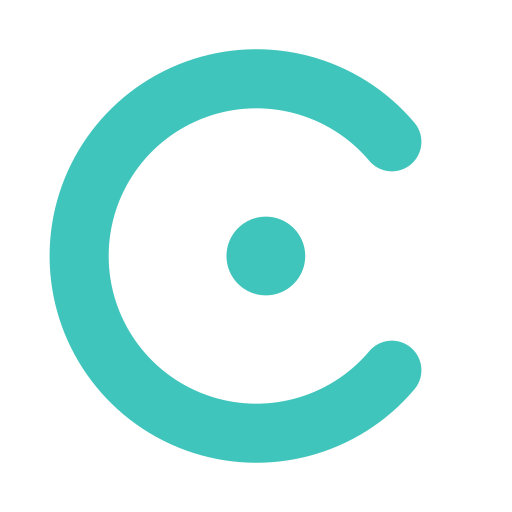
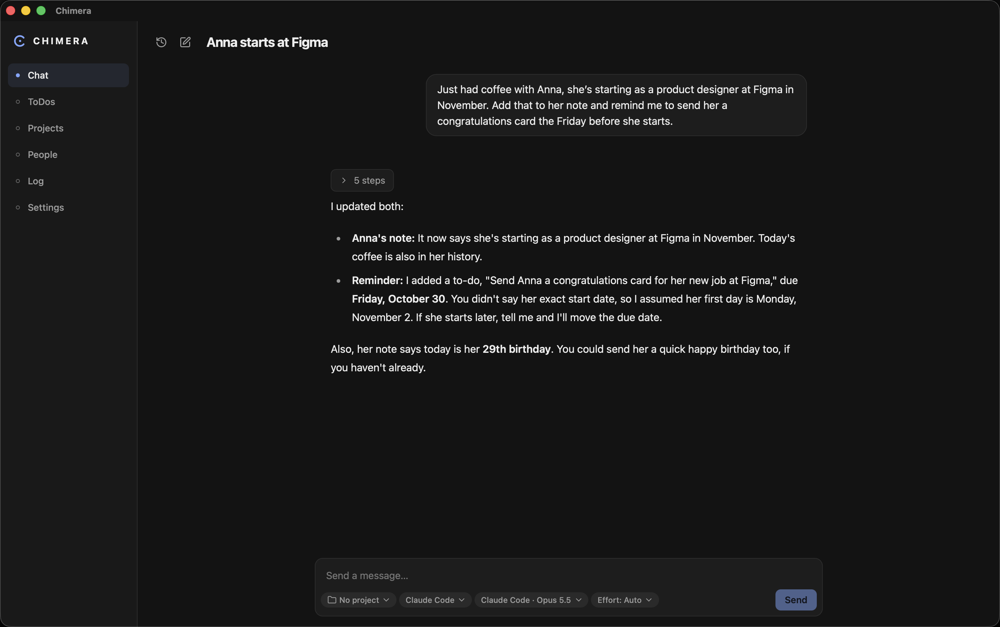

<div align="center">
  
  <h1>Chimera</h1>
  <p>A personal AI desktop app that brings your models, projects, ToDos, people and Obsidian vault together.</p>
</div>

<p align="center">
  <a href="#about">About</a> •
  <a href="#features">Features</a> •
  <a href="#planned-features">Planned Features</a> •
  <a href="#screenshot">Screenshot</a> •
  <a href="#tech-stack">Tech-Stack</a> •
  <a href="#architecture">Architecture</a> •
  <a href="#installation">Installation</a>
</p>

---

> This repository only hosts Chimera's release builds.

## About

Chimera is a all-in-one desktop app for integrating AI models from several providers with multiple harnesses and external data sources. Chimera brings many builtin features for managing work or life while integrating tightly with an obsidian vault.

A fleshed out permission system only allows whats really necessary while a detailed log makes every action tracable and offers the option to undo them.

## Features

### Chat with many models

- **Several providers in one app:** Claude Code (with your Claude subscription), OpenRouter (hundreds of models with one API key) and OpenCode
- **Interchangeable harnesses:** a turn can run in Chimera's own tool loop, in Claude Code or in any agent that speaks the [Agent Client Protocol](https://agentclientprotocol.com). Where a provider allows it, one harness runs another provider's models
- **Model and effort picker** with each model's context size, price and supported reasoning levels
- **Streaming replies** with thinking, tool calls and their results shown in the order they happened
- **Branching conversations:** edit a message or regenerate a reply to create variants, and switch between them
- **Automatic chat titles** written by a background model

### Tools with human approval

- **Models act on your data** through tools for projects, ToDos, people, memories and the vault
- **Approval for every change:** each proposed edit is shown as a diff and only applied after you approve it, and only if nothing changed while you were deciding
- **Shared tools for every harness:** the same tools are offered to external agents through a local MCP server
- **Read-only web and file tools** from Claude Code and OpenCode, each call approved by you or allowed for the rest of the chat

### Projects and ToDos

- **ToDos** with status, tags, due dates, milestones, assignees and correspondents
- **Project boards** with three columns, milestones that show the current phase, and a linked chat history
- **Chats in a project** get the project's current state with every message
- **Smart ToDos:** type a quick note like "Call Anna on Friday about the offer" and a background model turns it into a structured ToDo with a date, project and people

### Obsidian vault and people

- **Vault access** that's limited to the folders you choose, with excluded folders, hidden files and symlinks leading out of the vault all blocked
- **Vault mapping:** a model analyzes your vault's structure and conventions and saves them as a memory, so the notes it writes later look like yours
- **Automatic notes** for new projects and people, written by a background model and following those conventions
- **People** whose details live in their Obsidian note: relation, birthday with age, contact history and when you last spoke
- **What's next with each person:** their next birthday or the next open ToDo they're on

### Memory, log and undo

- **Core memories** that every chat knows, either sent in full or loaded only when a model needs them
- **Activity log** of every change made by you or a model, filterable by who made it and linked to the chat it came from
- **Undo and redo** for any logged change, including vault edits, with checks so later changes aren't overwritten

### Background tasks

- **A background model of your choice,** with a fallback model that takes over if the first one fails
- **Live progress** for each task, and a chat you can open to review and approve its changes

### Appearance

- **Themes:** Chimera, Chimera Light, Graphite, Dusk, Forest and Paper
- **Color editor** to fine-tune every color of the interface

## Planned Features

- **Calendar integration**
- **Mail integration and ingestion** (focusing on [Proton Mail Bridge](https://proton.me/mail/bridge))
- **Messenger integration** for common messengers (focusing on WhatsApp)
- **Scheduled tasks**
- **Cloud features** such as shared projects

## Screenshot

<p align="center">
  
</p>

## Tech-Stack

- **App shell**: [Tauri 2](https://tauri.app/) (Rust, edition 2024)
- **Frontend**: [Vue 3](https://vuejs.org/), [Vue Router](https://router.vuejs.org/), [Pinia](https://pinia.vuejs.org/), [Tailwind CSS 4](https://tailwindcss.com/), [TypeScript](https://www.typescriptlang.org/)
- **Build tooling**: [Vite](https://vite.dev/), [pnpm](https://pnpm.io/)
- **Async runtime**: [tokio](https://crates.io/crates/tokio)
- **Database**: SQLite through [rusqlite](https://crates.io/crates/rusqlite), with versioned migrations
- **HTTP and streaming**: [reqwest](https://crates.io/crates/reqwest) (OpenRouter, server-sent events)
- **MCP server**: [rmcp](https://crates.io/crates/rmcp) and [axum](https://crates.io/crates/axum) (streamable HTTP)
- **Secret storage**: [keyring](https://crates.io/crates/keyring) (macOS Keychain, Windows Credential Manager)
- **Markdown rendering**: [marked](https://marked.js.org/) and [DOMPurify](https://github.com/cure53/DOMPurify)
- **CI/CD**: GitHub Actions builds the macOS and Windows installers and publishes them here

## Architecture

```
            ┌──────────────────────── Vue 3 frontend ────────────────────────┐
            │  Chat · ToDos · Projects · People · Log · Settings             │
            └────────────────────────────────┬───────────────────────────────┘
                                             │ typed Tauri commands & event streams
┌────────────────────────────────────────────┴───────────────────────────────────────┐
│ Rust backend                                                                       │
│                                                                                    │
│   engine (contracts)  ◄──  chat · background tasks · plugins · tools               │
│                                                                                    │
│   Harnesses: Chimera's tool loop │ Claude Code CLI │ ACP agents (OpenCode)         │
│   Sources:   OpenRouter          │ Claude Code     │ OpenCode                      │
│                                                                                    │
│   Tools: called directly by Chimera's loop, and over a local MCP server by agents  │
│   SQLite (chats, ToDos, projects, people, memories, activity log) · OS keychain    │
└────────────────────────────────────────────────────────────────────────────────────┘
```

A few design decisions:

- **Pluggable providers:** each provider is a plugin that registers model sources, harnesses or both against a small set of traits. Adding an ACP agent only takes a short spec. A test keeps the layers apart: the engine depends on nothing else in the app, and plugins never depend on the chat code.
- **Protocol-based model sharing:** a source declares the API protocols it speaks (Anthropic- or OpenAI-compatible), and harnesses pick sources up by protocol, not by name. For example, Claude Code can run OpenRouter's Anthropic models without either side knowing about the other.
- **One tool set for every harness:** tools are written once. Chimera's own loop calls them directly, and external agents reach them through an MCP server on `127.0.0.1` that only accepts a secret token, new for every chat on every run.
- **One approval queue:** approval requests from Chimera's tools and from each agent's own tools go to a single queue in the chat, so you see them one at a time no matter which harness is running.
- **Changes are recorded with the change itself:** each log entry is written in the same database transaction as the change and stores the state before and after it. That's what lets undo, and undoing an undo, check for later changes safely.
- **Secrets stay out of the frontend:** API keys live in the OS keychain and are never sent to the web view. Claude Code logins are handled entirely by Claude Code.

## Installation

Download the installer for your platform from the [latest release](../../releases/latest):

| Platform              | File   |
| :-------------------- | :----- |
| macOS (Apple Silicon) | `.dmg` |
| Windows (x64)         | `.msi` |

The macOS build is ad-hoc signed, not notarized, so macOS blocks it the first time. To open it
anyway, remove the quarantine flag after moving the app to Applications:

```sh
xattr -cr /Applications/chimera-client.app
```

### Setting up providers

Open **Settings → Providers** and set up at least one:

- **Claude Code:** Chimera finds or installs the Claude Code CLI and starts the sign-in with your Claude account.
- **OpenRouter:** paste an API key from [openrouter.ai](https://openrouter.ai/keys). It's checked and stored in your OS keychain.
- **OpenCode:** install [OpenCode](https://opencode.ai) and sign in there. Chimera uses its models and logins.

To let models work with your notes, turn on the Obsidian vault in **Settings → General**, pick its
folder and click **Map my vault**.
